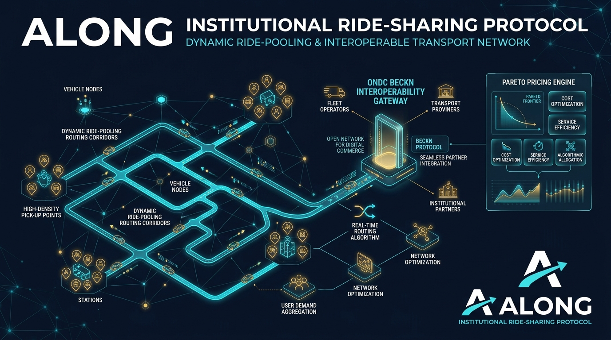

# ⚡ ALONG: Institutional Ride-Sharing Protocol
### *Hyper-Efficient Dynamic Mid-Ride Pooling & Interoperable Urban Mobility Engine*

<div align="center">



[](https://www.typescriptlang.org/)
[](https://nodejs.org/)
[](https://becknprotocol.io/)
[](./ALONG_Certification_Report.md)
[](LICENSE)

</div>

---

## 📌 Executive Summary

Traditional ride-sharing platforms suffer from a systemic trilemma: **rider detour fatigue**, **driver compensation erosion**, and **vulnerability to artificial surge gaming**. Fixed-route carpooling fails in dynamic urban environments, while ad-hoc mid-ride additions spark friction, cancel loops, and capacity violations.

**ALONG** is an institutional-grade mobility protocol engineered for hyper-dense corridors (such as Bangalore's Outer Ring Road or the Okhla-to-CyberHub spine). Powered by **DSMP-X** (Dynamic Surcharge & Margin Preservation) and **SIS** (System Integrity Score), ALONG turns ride-sharing into a cryptographically auditable, Pareto-optimal cooperative game that seamlessly interfaces with India's **ONDC / Beckn network**.

---

## 🏛️ System Architecture

```
                  ┌──────────────────────────────────────────────┐
                  │          ONDC / Beckn Network (TRV10)        │
                  └──────────────────────┬───────────────────────┘
                                         │ (Search / Select / Init / Confirm)
                                         ▼
                  ┌──────────────────────────────────────────────┐
                  │         ALONG Beckn Protocol Adapter         │
                  │   - Ed25519 Signatures  - Schema Validation  │
                  └──────────────────────┬───────────────────────┘
                                         │
                 ┌───────────────────────┴───────────────────────┐
                 ▼                                               ▼
   ┌───────────────────────────┐                   ┌───────────────────────────┐
   │    SIS Defense Engine     │                   │   DSMP-X Economic Engine  │
   │ - Anti-Collusion Rings    │                   │ - The Detour Tax          │
   │ - Surge Smoothing         │                   │ - Shared Value Pool       │
   │ - Defensive Guard Capping │                   │ - Pareto Pricing Frontier │
   └─────────────┬─────────────┘                   └─────────────┬─────────────┘
                 │                                               │
                 └───────────────────────┬───────────────────────┘
                                         ▼
                  ┌──────────────────────────────────────────────┐
                  │       Core Dispatch & Matching Cluster       │
                  │  - Fixed-Grid Spatial Snapper                │
                  │  - Permutation Optimizer (Sub-2ms Multi-TSP) │
                  │  - Mutual Multi-Rider Consent Enforcer       │
                  └──────────────────────┬───────────────────────┘
                                         │
                 ┌───────────────────────┴───────────────────────┐
                 ▼                                               ▼
   ┌───────────────────────────┐                   ┌───────────────────────────┐
   │  Deterministic Trace Engine│                  │ Firestore / DB Store      │
   │ - 100% Replay Auditability│                   │ - ACID Invariant Enforcer │
   │ - Dispute Resolution UI   │                   │ - Zero Illegal States     │
   └───────────────────────────┘                   └───────────────────────────┘
```

---

## 💡 Core Innovations

### 1. 💰 DSMP-X: Pareto-Optimal Pooling Economics
* **The Detour Tax**: Mathematically calculates the marginal cost of rider diversions. Rather than burning driver margin or forcing riders to endure arbitrary route shifts, detours above threshold penalties fund immediate rider rebates while keeping driver hourly earnings higher than solo trips.
* **Shared Value Pool**: A multi-lateral surplus redistribution algorithm. Riders receive up to **35–40% discounts**, drivers gain **20–25% higher vehicle-hour revenue**, and platform empty miles drop by up to **42%**.
* **Zero Marginal Harm Guarantee**: No existing passenger in an active ride can have their ETA expanded beyond strict, pre-consented SLA bounds.

### 2. 🛡️ SIS: Institutional Resilience & Anti-Cartel Defense
* **Cartel Detection**: Multi-agent algorithms continuously monitor driver cancellation clustering and geohash-level device ping delays to identify coordinated offline/online supply rings.
* **Surge Smoothing**: Damps sudden temporal shockwaves using exponential moving windows to prevent artificial surge induction.
* **Autonomous Defensive Mode**: If the System Integrity Score falls below safe thresholds ($SIS < 0.70$), the protocol automatically:
  1. Caps surge multipliers to 1.15x.
  2. Tightens pool radius to conservative proximity.
  3. Escalates dispute audits into deterministic replay logs.

### 3. 🌐 Native ONDC & Beckn Protocol Compliance
* Full interoperability with the **Beckn TRV10** taxonomy:
  * `search` ➔ Dynamic intent gathering & spatial snapping
  * `select` ➔ Candidate route permutation & Pareto quote generation
  * `init` ➔ Luggage (boot capacity) and seat invariant validation
  * `confirm` ➔ Cryptographic trip commitment with Ed25519 digital signatures
* Allows any Beckn-enabled consumer app (Namma Yatri, Paytm, PhonePe, custom BAP) to participate in shared high-occupancy corridors.

### 4. 🔬 Deterministic Trace Engine & Replay Verification
* Every state transition is recorded as an immutable log event with nanosecond-resolution sequence counters.
* Integrated **Dispute Replay Engine** allows operators, regulators, and passengers to reconstruct the exact matching timeline, verifying that consent was collected, capacity was never violated, and fare math was executed honestly.

---

## 📊 Stress Test & Certification Audit

The engine has undergone rigorous validation across multiple layers in the **Omega Audit Suite**:

| Metric | Target | Verified Value | Status |
| :--- | :--- | :--- | :--- |
| **Deterministic Edge Cases** | 150 test suites | 150 / 150 Passed | ✅ 100% |
| **Monte Carlo Stress Test** | 5,000 concurrent requests | 5,132 processed | ✅ Verified |
| **Average Match Latency** | $< 10\text{ ms}$ | **1.09 ms** | ⚡ Ultra-fast |
| **Max Processing Latency** | $< 50\text{ ms}$ | **11.96 ms** | ⚡ Deterministic |
| **Illegal States / Overflows** | 0 allowed | **0 detected** | 🛡️ Zero Violations |
| **Replay Determinism** | 100% bit-exact | **100% exact** | 🔒 Audit Certified |
| **CO2 Emission Abatement** | $> 1.0\text{ ton / 1k rides}$ | **1.5 tons / 1k rides** | 🌿 Sustainable |

*Refer to the full [ALONG Certification Report](./ALONG_Certification_Report.md) and [Regulator Audit Report](./ALONG_Regulator_Report.md) for complete telemetry.*

---

## 🗂️ Repository Structure

```
├── backend/
│   ├── core/                      # Protocol mathematics & state invariant engines
│   │   ├── stateMachine.ts        # Immutable state lifecycle transitions
│   │   ├── invariants.ts          # Capacity, detour, and consent invariant checks
│   │   ├── PermutationOptimizer.ts# Sub-second spatial TSP route optimizer
│   │   ├── ClusterExpansionEngine.ts# Multi-rider clustering logic
│   │   ├── TraceEngine.ts         # Deterministic audit replay logger
│   │   ├── CertificationWarGame.ts# Monte Carlo & deterministic stress suites
│   │   └── reproduce_l3.ts        # L3 Chaos stress reproduction script
│   ├── services/
│   │   ├── becknAdapter.ts        # ONDC TRV10 integration layer
│   │   ├── pricingService.ts      # DSMP-X Detour Tax & Surge Smoothing
│   │   ├── collusionSuite.ts      # Anti-cartel & coordinate ring detector
│   │   ├── maliceSuite.ts         # Adversarial edge case auditor
│   │   └── rideMatchingService.ts # Real-time pooling orchestration
│   ├── api/
│   │   ├── DisputeReplayUI.tsx    # Interactive UI for timeline audit replay
│   │   ├── dispatch.ts            # Dispatch endpoints
│   │   └── router.ts              # Express/Node route handler
│   ├── db/
│   │   └── schema.sql             # Relational schema with ACID lock contracts
│   └── agent_configs/             # Autonomous agent parameters (auditor, negotiator)
├── src/                           # Frontend dashboard (React 19 + Vite)
├── assets/                        # Architecture graphics & diagrams
├── ALONG_Certification_Report.md  # Official certification war-game audit
├── ALONG_Regulator_Report.md      # Regulatory compliance submission
└── run_demo.ps1                   # Interactive PowerShell launcher
```

---

## 🚀 QuickStart & Local Setup

### Prerequisites
* **Node.js**: v18.0.0 or higher
* **npm**: v9.0.0 or higher

### 1. Clone & Install
```bash
git clone https://github.com/aditya25058/ALONG_RAID.git
cd ALONG_RAID
npm install
```

### 2. Run the Interactive Dashboard
Launch the development server:
```bash
npm run dev
```
Navigate to `http://localhost:5173/` to view the Protocol Dashboard and interactive controls.

### 3. Run the One-Click Demo (Windows PowerShell)
```powershell
.\run_demo.ps1
```

### 4. Execute the L3 Stress & Chaos Suite
Run the protocol reproduction suite to benchmark performance and verify zero invariant violations:
```bash
npm run reproduce-l3
```

---

## 🔒 Security & Invariants Guarantee

1. **Strict Seat & Boot Non-Exceedance**: Vehicles strictly cannot be dispatched in states where physical seating capacity or trunk volume is violated ($C_{passengers} \le C_{vehicle}$, $B_{luggage} \le B_{boot}$).
2. **Pre-Agreed Consent Hash**: Route modifications recalculate a sha256 geometric path hash. A pool confirmation is only committed if both parties cryptographically sign the detour window.
3. **Double-Spend & Ghost-Booking Rejection**: All transaction dispatches enforce strict idempotency keys with rollback isolation.

---

## 📄 License & Compliance

Licensed under the [Apache License, Version 2.0](LICENSE).  
Compliant with Open Network for Digital Commerce (ONDC) mobility guidelines and Beckn TRV10 transaction specifications.
